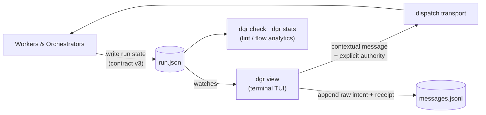

# dgr

[](https://github.com/unsigned-gg/.github)

Mathematical and machine-sympathetic directed acyclic graph (DAG) execution runtime, state engine, and live terminal visualization in pure Rust.

[](https://raw.githubusercontent.com/unsigned-gg/dgr/main/assets/pane-cockpit.png)

`dgr` is an open-source (Apache-2.0 / MIT) engine for representing, validating, and interacting with complex directed acyclic workflows. It treats workflow execution as compiled microcode on silicon: strict mathematical invariants, bit-parallel dependency resolution, and zero-allocation critical path math, separating work claims from verification receipts.

## Key Capabilities

- **Mathematical DAG Integrity.** Strict cycle detection across dependencies (`deps`) and fan-in gates (`inputs`), topological sorting, transitive reduction, Critical Path Method (CPM), and flow templates.
- **Zero-Bloat Machine Sympathy.** Written in pure Rust with minimal dependencies (`crossterm`, `serde`, `unicode-width`, `chrono`). High throughput, instant startup, sub-millisecond linting.
- **Terminal Visualization.** Interactive terminal UI drawn like `git log --graph`, responsive from 20 columns to 4,000+ columns, with folding, subtree zoom, incremental search (`/`), and mouse selection with OSC 52 clipboard export.
- **Strict Run-State Contract.** Versioned schema ([`CONTRACT.md`](CONTRACT.md)) enforced by `dgr check`. Separates tasks from attempts, tracks causes (`sent_back`, `gate_failed`, `followup`, `superseded`), and grades completions by evidence tier (`◆ verified`, `◇ reported`, `≈ heuristic`, `! asserted`).
- **Flow Analytics.** `dgr stats` computes critical path, bottleneck analysis, time-in-state, rework rate, WIP, and naive completion estimates directly from timestamped attempt logs.
- **Operator In-The-Loop.** Contextual message composer (`m`) with append-only immutable journaling (`messages.jsonl`) and explicit authority scopes (`recommend_and_return` vs `may_decide_and_continue`).
- **Agent Skill Included.** Self-onboarding `dgr-producer` skill bundled directly in the binary (`dgr --skill`).

---

## Quickstart

### Installation

Install via Cargo:

```sh
cargo install dgr
```

Or build from source:

```sh
git clone https://github.com/unsigned-gg/dgr.git
cd dgr
cargo build --release --locked
```

### CLI Usage

```sh
# Lint a run-state document against the contract
dgr check run.json --strict --json

# View live interactive DAG (or export static frames)
dgr view run.json
dgr view run.json --snapshot --compact --width 120

# Flow analytics and critical path calculation
dgr stats run.json --json

# Print the agent-facing producer skill
dgr --skill
```

---

## Architecture & Contract

`dgr` is a **representation kernel, not an enforcement scheduler**. The runtime asserts truth, and `dgr` verifies the mathematical structure and presents live signals.



### The State Grammar

```text
├─● L3 contract freeze        done ◆ verified   12m
├─✗ L4·a1 impl: gate schema   sent back        10m  builder-2  ✗ operator "err paths untested"
├↩● L4·a2 impl: gate schema   done ◇ reported   7m  builder-2
├─◎ L5 impl: renderer core    working          14m  builder-1
│ ╰┄○ L5r review              (future: on done)
├─●◎●→⋈ G2 integration gate   waits L5r
```

- Gate rows display state-bearing joins (`●◎●→⋈ G2`) in declared input order.
- Retries append new attempts with backward-pointing causal links (`↩`).
- Canceled work remains historically visible without breaking graph continuity.
- Futures from loop policies appear in dotted ink (`╰┄○`).
- Completed attempts require concrete evidence tiers:
  - `◆ verified`: Mechanically checked (test run, commit SHA, formal proof).
  - `◇ reported`: Structured typed result envelope.
  - `≈ heuristic`: Inferred from runtime signals or exit codes.
  - `! asserted`: Unverified prose assertion.

---

## Terminal Navigation

| Key | Action |
|---|---|
| `j` / `k` | Move cursor down / up (`g` / `G` for top / bottom) |
| `Tab` | Cycle through attention queue items |
| `d` | Open focus neighborhood and scrollable detail card |
| `←` / `→` | Fold / unfold branch under cursor |
| `z` | Fold all settled nodes in one keystroke |
| `f` | Quick file picker across recent runs |
| `/` | Incremental row search (by id, title, or actor) |
| `m` | Open operator message composer |
| `y` | Copy selected node id to clipboard |
| `r` | Force reload |
| `?` | Toggle help overlay |
| `q` | Quit |

---

## Repository Structure

- [`CONTRACT.md`](CONTRACT.md): The normative v3 run-state specification and finding codes.
- [`src/`](src/): Pure Rust engine implementation:
  - `check.rs`: Linear-time structural and semantic validator.
  - `contract.rs`: Permissive deserialization types for schema versions 1, 2, and 3.
  - `flow/`: Directed acyclic graph algorithms, topological sorting, transitive reduction, and CPM.
  - `render.rs`: Responsive ANSI TUI renderer and detail card generator.
  - `view.rs`: Interactive event loop, crossterm raw mode, and file watcher.
  - `stats.rs`: Flow and throughput analytics engine.
- [`skills/dgr-producer/`](skills/dgr-producer/SKILL.md): Standardized agent skill for generating and maintaining valid run files.
- [`specs/`](specs/README.md): Architecture specifications (LeanSpec + EARS) and multi-horizon development roadmap ([SPEC-0001](specs/SPEC-0001-dgr-architecture-and-roadmap.md)).
- [`samples/`](samples/): Canonical test fixtures (`run.json`, `states.json`).

---

## License

Licensed under either of:

- [Apache License, Version 2.0](LICENSE-APACHE)
- [MIT License](LICENSE-MIT)

at your option.

## Principles

See the [unsigned-gg principles](https://github.com/unsigned-gg/.github) for the architectural doctrine and community standards.
